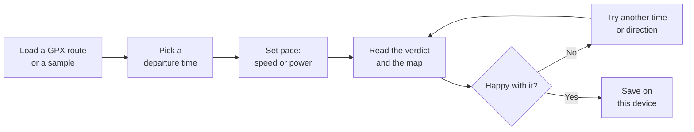

# RideWind product overview

RideWind tells a cyclist what the wind will do on a planned ride: where it will be a headwind, crosswind or tailwind, at the time they'll actually reach each part of the route. It's a free, private web app. You load a GPX file, pick a departure time, and get a one-line answer plus a coloured map, with no account and no upload.

This page covers why RideWind exists and what it should and shouldn't do. Setup lives in the [README](README.md), the maths in [how RideWind estimates your ride](docs/model.md), and planned work in the [roadmap](ROADMAP.md).

## What problem does RideWind solve?

A normal forecast gives wind for one place at one hour. A long ride crosses many places over several hours, and the direction you're riding keeps changing. So "15 km/h from the west" doesn't tell you whether the hard part of the ride will be into the wind or with it.

RideWind works out:

- Your arrival time at each point, from a fixed average speed or from your power.
- The forecast wind, gusts, temperature and rain for the hour you're expected at each point.
- Whether each section is a headwind, crosswind, tailwind or calm, by comparing the wind direction with your direction of travel.

It also helps with the decision that comes next: leave earlier or later, or ride the route the other way round.

## Who is RideWind for?

RideWind is for road cyclists who plan rides in advance and already have the route as a GPX file. It is most useful to:

- Riders planning long rides, where the wind changes over several hours. The longest bundled sample is a 140 km ride in the San Francisco Bay Area.
- Riders who can choose when to leave or which way to ride, and want the option with the least headwind.
- Riders who train with power, who can get ride times from their power, weight and bike setup instead of a guessed average speed.
- Riders who care about privacy, who don't want to create an account or upload their routes.

## How do cyclists use it?

There are four core journeys:

1. **Check a planned ride.** Load the route, keep the default departure, and read the verdict, for example *Mostly crosswind · gusts 43 km/h · rain up to 4.3 mm/h · finish 01:35 PM · sunset 04:57 PM*.
2. **Choose the best time or direction.** Step the departure time an hour at a time, use a preset such as *Tomorrow 08:00*, or compare up to six times in both directions. RideWind marks the best option, and **Use** applies it.
3. **Get a realistic ride time.** Switch to **Power and bike setup**. If the route has no elevation, choose whether to look it up or to estimate it as flat.
4. **Keep and move routes.** Save routes in the browser, and export them as a file to move them to another device.

## What can RideWind do today?

| Area | What works now |
| --- | --- |
| Routes | Imports GPX track or route points. Three Bay Area sample routes. Can reverse the route. |
| Forecast | Hourly wind, gusts, temperature and rain from Open-Meteo, up to 16 days ahead, at up to 40 points per route. Sunrise and sunset. |
| Timing | Constant average speed, or a power-based physics model that uses gradient, wind, weight, drag and rolling resistance. Optional planned stop time. |
| Elevation | Uses the GPX elevation when there is some. Optional lookup when there isn't. Never quietly treats a route as flat. |
| Results | One-line verdict, a map coloured by wind type, charts along the route, a departure comparison and a point-by-point table. |
| Daylight | Notes when a ride starts before sunrise or finishes after sunset. |
| Storage | Settings and saved routes stay in the browser. Export, import and delete everything. Nothing syncs. |
| Access | Works by keyboard, announces results to screen readers, doesn't rely on colour alone, and works at phone width. See [Accessibility](ACCESSIBILITY.md) for the gaps. |

## What principles guide decisions?

These come from choices already made in the code and in earlier pull requests.

- **Answer first.** The verdict comes before the detail. On phones it sits in a bar at the bottom of the screen.
- **Say what is forecast and what is estimated.** Forecast values and RideWind's own estimates are labelled differently. A result that falls outside the forecast window says so instead of guessing.
- **Never hide a guess.** A route without elevation is shown as unknown, not flat. A flat estimate is only used when you choose it, and it's labelled.
- **Keep the rider's data private.** There's no backend and no account. The GPX file never leaves the browser, and only coordinates rounded to about 100 m go to the weather service.
- **Use the free weather service lightly.** One forecast request per route, cached in memory. Changing the time, pace or direction doesn't call the service again. The elevation lookup only runs when you ask, and it tells you its cost first.
- **Don't depend on colour.** Wind type is also shown by line style, patterns and text.
- **Be honest about limits.** Forecast wind doesn't account for shelter from trees, buildings or terrain, and the estimates have only been checked against five real rides, where they came within about 11%. The app and the docs both say so.

## What is RideWind not trying to be?

These limits follow from the current design, the data licence and the project's stated purpose.

- Not a service with accounts. There's no sign-in and no cloud sync. Moving data between devices is a manual export and import.
- Not a commercial product. It's a personal, non-commercial project, which the free Open-Meteo plan requires.
- Not race or pacing advice. The ride time is a planning estimate. The model leaves out stops, corners, traffic, drafting and fatigue.
- Not a route planner. You bring a GPX route. RideWind doesn't draw or edit routes.
- Not a copy of any commercial cycling weather service. It isn't affiliated with one and makes no claim to match one.
