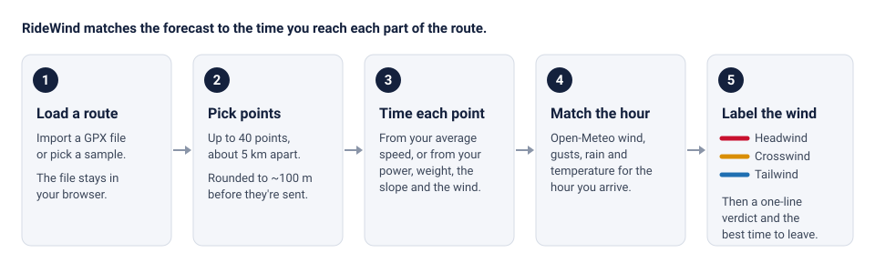

# RideWind

[](https://github.com/kchan1028/ridewind/actions/workflows/ci.yml)

RideWind shows you the wind you'll actually ride into. Load a GPX route and pick a departure time. RideWind matches the forecast wind, gusts, temperature and rain to the moment you reach each part of the route, and colours the map by headwind, crosswind and tailwind.

It runs entirely in your browser. There's no account and no server, and your route file is never uploaded.

**[Open RideWind](https://kchan1028.github.io/ridewind/)**, then choose a route from **Try a sample route…** to see it working in a few seconds. · [Documentation](docs/README.md) · [Report an issue](https://github.com/kchan1028/ridewind/issues)



## Why use it

- See where the wind will hit you at the time you'll be there. The map is coloured by wind type, and one line sums up the ride, such as *Mostly crosswind · gusts 43 km/h · rain up to 4.3 mm/h · finish 01:35 PM · sunset 04:57 PM*.
- Pick a better time or direction. Move the start an hour earlier or later, use a preset like *Tomorrow 08:00*, or compare up to six start times in both directions. RideWind marks the best one.
- Base the timing on your power if you want to. Instead of a flat average speed, RideWind can use your power, weight, position on the bike, tyres, the slope and the wind. As a sanity check, a 200 W rider at 84 kg (rider plus bike) comes out at about 33 km/h on a calm, flat road.
- Keep your rides private. Settings and saved routes stay in your browser. Only coordinates rounded to about 100 m go to the weather service, and timestamps and other recorded data in your GPX file are thrown away.

## Quick start

**Prerequisites:** [Node.js](https://nodejs.org/) 20.19 or newer (CI uses Node 22), and npm.

```bash
git clone https://github.com/kchan1028/ridewind.git
cd ridewind
npm install
npm run dev
```

When the dev server is ready, Vite prints something like:

```
  VITE v8.3.8  ready in 132 ms

  ➜  Local:   http://localhost:5173/
```

Open that address in your browser. If port 5173 is busy, Vite picks the next free port and prints that one instead.

**Configuration:** none is needed. The forecast and elevation services need no API key, and there's no `.env` file. The only environment variable is the optional `BASE_PATH`, used when the built site is served from a subpath such as GitHub Pages:

```bash
BASE_PATH=/ridewind/ npm run build
```

## Usage

1. **Load a route.** Press **Import GPX** and choose a `.gpx` file with track or route points. Or pick one of the three San Francisco Bay Area samples from **Try a sample route…**:
   - Berkeley to Morgan Territory
   - China Camp and Nicasio Valley
   - PRS (clockwise)
2. **Choose when you'll leave.** Departure times use the route's own timezone. Use the date and time field, a preset, or the **−1 h / +1 h** buttons in the verdict.
3. **Set your pace.** Choose **A constant average speed**, or **Power and bike setup** for the physics estimate. A route without elevation data asks you to look elevation up or explicitly estimate it as flat; it never quietly assumes a flat route.
4. **Read the result.** The verdict at the top (a bar along the bottom on phones) gives the answer. Below it you'll find the ride-time and weather figures, charts along the route, the departure comparison and a point-by-point table.

On 14 November 2026, the **Berkeley to Morgan Territory** sample at the default 25 km/h, leaving at the **Tomorrow 08:00** preset, gave this verdict:

```
Berkeley to Morgan Territory · 139.8 km
Mostly crosswind
gusts 43 km/h · rain up to 4.3 mm/h · 5 h 36 min, finish 01:35 PM · sunset 04:57 PM
```

Forecasts change, so your numbers will differ. To keep a route, press **Save on this device**. Data is never synced; to move it to another device, use **Data & settings → Export data** and then **Import data**.

RideWind is a planning aid. Forecast wind doesn't fully account for shelter from buildings, trees or terrain, and the estimates haven't been checked against real rides. For the details, see [how RideWind estimates your ride](docs/model.md).

## Common questions

### How does RideWind know which way the wind hits me?

RideWind compares the forecast wind direction with the direction you're riding at each point. Wind within 45° of straight in your face is a headwind, within 45° of straight behind you is a tailwind, and anything else is a crosswind. Wind under 5 km/h counts as calm.

### Where does the weather forecast come from?

The forecast comes from [Open-Meteo](https://open-meteo.com/), a free weather service. RideWind asks for up to 16 days of hourly wind, gusts, temperature and rain at up to 20 points along your route, then uses the hour you're expected to reach each point.

### Is the wind on the map what I'll feel on the bike?

Usually not quite. The forecast is for wind 10 m above open ground, so you'll often feel less at road level, especially behind hedges, trees or buildings. In power mode you can tell RideWind how sheltered the route is, and it scales the wind down to rider height.

### Does RideWind upload my GPX file?

No. The file is read in your browser and never uploaded. RideWind sends only up to 20 points, rounded to about 100 m, to Open-Meteo, plus the usual map tile requests to OpenStreetMap. See [data sources and privacy](docs/data-and-privacy.md).

### What if my route has no elevation?

RideWind never quietly treats a route as flat. Climbing shows as unknown, and power mode asks you to either look up terrain elevation from Open-Meteo or choose **Estimate as if flat**, which labels the result as a flat estimate.

### Is RideWind free?

Yes. RideWind is a free, open-source personal project for non-commercial use, and it needs no account or API key.

## Documentation

- [How RideWind estimates your ride](docs/model.md): sampling, time matching, wind components, the physics model (Martin et al., 1998) and comparisons.
- [Data sources and privacy](docs/data-and-privacy.md): Open-Meteo usage and limits, attribution, map tiles, and what is stored in your browser.
- [Deploying RideWind](docs/deployment.md): building the static site and publishing it with GitHub Pages.
- [Maintaining RideWind](docs/maintaining.md): branch rules and how changes reach `main`.
- [Security policy](SECURITY.md): how to report a vulnerability privately, and how RideWind handles your data.
- [Accessibility](ACCESSIBILITY.md): what's supported, known gaps, and how to report a barrier.

## Development

| Command | What it does |
| --- | --- |
| `npm run dev` | Start the Vite dev server with hot reload |
| `npm test` | Run the unit tests once (Vitest) |
| `npm run test:watch` | Run the tests in watch mode |
| `npm run typecheck` | Type-check with TypeScript |
| `npm run build` | Type-check, then build the static site into `dist/` |
| `npm run preview` | Serve the production build locally |

Built with TypeScript, Vite and Leaflet, with no UI framework. The calculations live in `src/lib/` and are kept separate from the interface in `src/ui/`:

```
src/lib/          Route, weather and ride calculations (unit-tested)
  gpx.ts            GPX → route (track or route points)
  geo.ts            distance, bearing, sampling, elevation stats
  weather.ts        Open-Meteo client and response validation
  forecast-match.ts forecast value at an arrival time
  wind.ts           head/cross components and classification
  ride.ts           combines the above into a ride plan
  physics.ts        cycling power model (Martin et al. 1998)
  simulate.ts       steps along the route: speed, timing, weather per step
  compare.ts        departure-time and direction comparison
  elevation.ts      opt-in Open-Meteo elevation lookup
  daylight.ts       sunrise/sunset relative to the ride
  presets.ts        quick departure choices
  verdict.ts        one-line wind summary
  time.ts           route-timezone conversions
  storage.ts        localStorage settings, IndexedDB routes, export/import
src/ui/           Leaflet map, charts and DOM wiring
tests/            Vitest unit tests
public/samples/   The bundled sample routes
```

### Contributing

There's no separate contributing guide yet. Changes reach `main` through pull requests, and the `test-build` check (tests plus a production build) must pass before merging. [Maintaining RideWind](docs/maintaining.md) explains the branch rules. To report a bug or suggest an idea, [open an issue](https://github.com/kchan1028/ridewind/issues). Report security problems privately as described in [SECURITY.md](SECURITY.md).

## Credits and licence

- **Code:** [MIT License](LICENSE).
- **Weather and elevation data:** [Open-Meteo.com](https://open-meteo.com/), [CC BY 4.0](https://creativecommons.org/licenses/by/4.0/).
  - Looked-up elevation uses the Copernicus DEM GLO-90: © DLR e.V. 2010–2014 and © Airbus Defence and Space GmbH 2014–2018, provided under COPERNICUS by the European Union and ESA. All rights reserved.
- **Map data:** © [OpenStreetMap](https://www.openstreetmap.org/copyright) contributors, ODbL.

RideWind is an independent personal project for non-commercial use. It isn't affiliated with or endorsed by any commercial cycling weather service.
