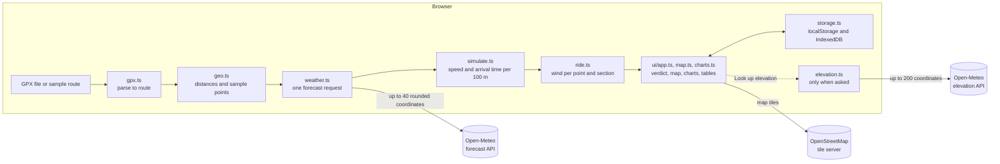
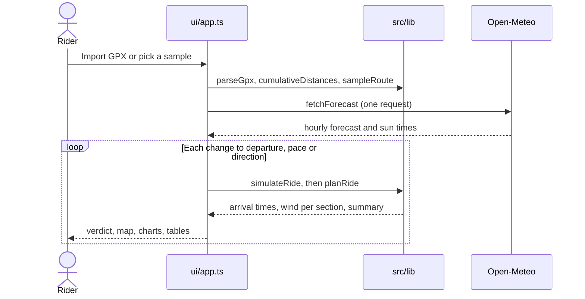

# How RideWind is built

RideWind is a static web page with no server of its own. One file of interface code, [`src/ui/app.ts`](../src/ui/app.ts), handles the page. It calls small, tested functions in [`src/lib/`](../src/lib) that turn a GPX route and one forecast request into a timed ride plan. The only outside services are Open-Meteo for weather and elevation, and OpenStreetMap for map tiles. Both are called straight from the browser.

This page explains the main parts, how data moves between them, and where to make common changes. The maths behind the estimates is in [model.md](model.md). Commands and setup are in [development.md](development.md).

## The big picture

Everything inside the box runs in the rider's browser. The three services on the right are the only network calls the app makes, and the production build's Content Security Policy ([`src/lib/csp.ts`](../src/lib/csp.ts)) blocks any others.

## What happens when a route loads

1. **Parse.** A drawn route skips this step: [`buildDrawnRoute`](../src/lib/draw.ts) turns the points into a `Route` and calls the same `loadRoute`. For a file, `app.ts` refuses files over 25 MB (`MAX_GPX_BYTES`). Then [`parseGpx`](../src/lib/gpx.ts) reads the file with the browser's `DOMParser`. It keeps only latitude, longitude and elevation, and throws an `AppError` with a plain message if the file is empty, not GPX or has fewer than two usable points.
2. **Measure.** [`cumulativeDistances`](../src/lib/geo.ts) works out how far along the route each point is. [`sampleRoute`](../src/lib/geo.ts) picks up to 40 evenly spaced points, about 5 km apart, for the forecast.
3. **Fetch the forecast.** [`fetchForecast`](../src/lib/weather.ts) sends one request for all sample points, rounded to about 100 m. It gets 16 days of hourly temperature, rain and wind, plus sunrise and sunset. The response is checked and kept in memory as a `ForecastBundle`.
4. **Pick a departure.** The forecast tells the app the route's timezone. [`src/lib/time.ts`](../src/lib/time.ts) converts between that local time and UTC, so departure times mean the same thing wherever the rider's device is.
5. **Simulate the ride.** [`simulateRide`](../src/lib/simulate.ts) walks the route in 100 m steps. For each step it finds the forecast for the moment the rider gets there, then works out a speed. That speed is either the rider's constant average speed or, in power mode, the speed from [`solveSpeed`](../src/lib/physics.ts). The clock moves forward step by step.
6. **Plan.** [`planRide`](../src/lib/ride.ts) uses those arrival times to match each sample point and each map section to its forecast. It splits the wind into headwind and crosswind with [`windComponents`](../src/lib/wind.ts), labels each section headwind, tailwind, crosswind or calm, and adds up a summary.
7. **Show.** `app.ts` writes the verdict ([`windVerdict`](../src/lib/verdict.ts) and [`rideDaylight`](../src/lib/daylight.ts)), the figures and the tables. [`RouteMap`](../src/ui/map.ts) colours the route and [`renderCharts`](../src/ui/charts.ts) draws the charts.

Steps 5 to 7 run again whenever the rider changes the departure time, pace or direction. They're fast and use the forecast already in memory, so no new request is sent. The one exception: if reversing the route moves the sample points, the app fetches a forecast for the new points.

## The parts

### Calculations: `src/lib/`

These modules are plain TypeScript with no access to the page. Most take numbers and arrays and return new ones, which is why they're easy to test. Each has a matching file in [`tests/`](../tests).

| Module | What it's responsible for |
| --- | --- |
| [`gpx.ts`](../src/lib/gpx.ts) | Reads GPX track points or route points into a `Route`. Throws on bad files. |
| [`draw.ts`](../src/lib/draw.ts) | Adds and undoes points of a route drawn on the map, fills each straight leg with points every 100 m, builds the `Route` (source `drawn`, no elevation) and writes GPX for **Export GPX**. |
| [`geo.ts`](../src/lib/geo.ts) | Distances, bearings, forecast sample points, map sections, elevation gain and loss, and reversing a route. |
| [`weather.ts`](../src/lib/weather.ts) | Builds the Open-Meteo forecast request, checks the response, and turns network problems into `AppError`s. Its `openMeteoGet` is shared with the elevation lookup. |
| [`forecast-match.ts`](../src/lib/forecast-match.ts) | Finds the forecast at an exact time by blending the hours either side of it. |
| [`wind.ts`](../src/lib/wind.ts) | Splits wind into headwind and crosswind for a direction of travel, and labels it. |
| [`physics.ts`](../src/lib/physics.ts) | The cycling power model: the power needed for a speed, and the speed for a given power. |
| [`simulate.ts`](../src/lib/simulate.ts) | Walks the route in steps to get speed and arrival time at every point. |
| [`ride.ts`](../src/lib/ride.ts) | Combines the route, the forecast and the arrival times into a `RidePlan`. |
| [`compare.ts`](../src/lib/compare.ts) | Runs the same plan for several departure times in both directions, and picks the best. |
| [`elevation.ts`](../src/lib/elevation.ts) | Looks up terrain elevation for routes without it. Runs only when the rider presses **Look up elevation**. |
| [`daylight.ts`](../src/lib/daylight.ts), [`verdict.ts`](../src/lib/verdict.ts), [`presets.ts`](../src/lib/presets.ts) | The verdict text, the sunrise and sunset check, and the quick departure buttons. |
| [`time.ts`](../src/lib/time.ts), [`units.ts`](../src/lib/units.ts) | Timezone conversion and formatting, and metric or imperial display. |
| [`storage.ts`](../src/lib/storage.ts) | Settings in `localStorage`, saved routes in IndexedDB, and checking export files before import. |
| [`errors.ts`](../src/lib/errors.ts) | `AppError`, the error type with a fixed code and a message for the rider. |
| [`csp.ts`](../src/lib/csp.ts) | The Content Security Policy that [`vite.config.ts`](../vite.config.ts) adds to the production build. |

### Interface: `src/ui/` and `index.html`

There's no UI framework. [`index.html`](../index.html) holds all the markup. [`src/main.ts`](../src/main.ts) loads the styles and calls `initApp()`.

- [`app.ts`](../src/ui/app.ts) keeps one `state` object (the current route, forecast, departure time, plan and settings) and the functions that change it. `loadRoute` starts everything for a new route. `loadForecast` fetches the weather. `recompute` reruns the simulation and redraws. Event handlers are attached in `initApp`.
- [`map.ts`](../src/ui/map.ts) wraps [Leaflet](https://leafletjs.com/). It draws the route, colours each section by wind type with a matching dash pattern, and adds wind arrows. In draw mode it hides the route, reports clicks, taps and Enter (at the centre crosshair) as new points, and shows the draft.
- [`charts.ts`](../src/ui/charts.ts) draws the elevation, wind, speed and temperature charts as SVG, each with a text summary for screen readers.

## Errors

Anything the rider might see goes through `AppError` ([`src/lib/errors.ts`](../src/lib/errors.ts)). Each one has:

- a `code` such as `WEATHER_RATE_LIMITED` or `GPX_NOT_GPX`, which code and tests can check;
- a `message` written for the rider, such as *Couldn't reach Open-Meteo. Check your connection and retry. Your route is still loaded.*;
- sometimes a `detail` with the technical reason, and for rate limits, `retryAfterSeconds`.

`app.ts` shows the message in the status line. A forecast error shows in the verdict instead, with one **Retry forecast** button, and is announced once. A failed forecast never clears the loaded route. Forecast requests give up after 20 seconds (`REQUEST_TIMEOUT_MS`), so the page never spins forever.

One error is a deliberate stop rather than a failure. In power mode, `simulateRide` throws `ELEVATION_MISSING` when the route lacks elevation, unless the rider has chosen **Estimate as if flat**. The app catches it and asks the rider to choose. This keeps a missing elevation profile from quietly turning into a flat course.

## Where to make common changes

| You want to… | Change this | Then check |
| --- | --- | --- |
| Add a forecast value, such as humidity | `HOURLY_VARIABLES` and `parseForecastResponse` in `weather.ts`, `weatherAt` in `forecast-match.ts`, then the display in `app.ts` | `tests/weather.test.ts`, `tests/forecast-match.test.ts`. Confirm the request still costs one call per location. |
| Change how speed is estimated | `physics.ts` and `simulate.ts` | `tests/physics.test.ts`, `tests/simulate.test.ts`, and [model.md](model.md) |
| Change the headwind or crosswind cut-offs | `classifyWind` and `CALM_BELOW_KMH` in `wind.ts` | `tests/wind.test.ts`, the legend in `index.html`, and [model.md](model.md) |
| Add a sample route | Put the `.gpx` file in `public/samples/` and add an `<option>` to `#sample-select` in `index.html` | Load it in the browser |
| Add a setting | `Settings`, `DEFAULT_SETTINGS` and `validSettings` in `storage.ts`, a field in `index.html`, then `applySettingsToInputs` and `bindPaceForm` in `app.ts` | `tests/storage.test.ts`. Old saved settings must still load. |
| Call a new outside service | Add its address to `CSP_DIRECTIVES` in `csp.ts` | `tests/csp.test.ts`, `npm run build && npm run preview`, and [data-and-privacy.md](data-and-privacy.md) |

## Things that aren't obvious

- **Sample points are symmetric.** `sampleRoute` spaces points evenly from both ends, so a reversed route usually gets the same points in reverse order and reuses the forecast.
- **Rain and gusts belong to the hour before.** Open-Meteo reports rain and gusts for the hour that ends at each timestamp, so `weatherAt` uses the hour that contains the arrival time instead of blending.
- **Wind direction is blended the short way round.** Halfway between 350° and 10° is 0°, not 180°.
- **No forecast is never filled in.** Points reached after the forecast ends get no weather and show as *No forecast*. In power mode the simulation assumes still air and 15 °C for those steps and the app shows a warning.
- **Saved data is versioned.** The settings key is `ridewind:settings:v1` and export files carry `version: 1`. If you change either format, keep old data loading or bump the version.
