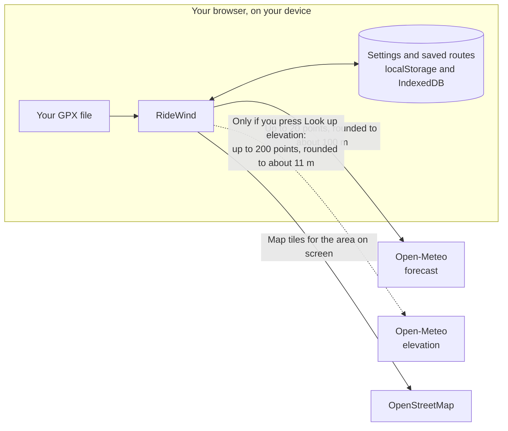

# Data sources and privacy

Your route file never leaves your browser. RideWind sends only up to 20 route points, rounded to about 100 m, to Open-Meteo for the forecast, and requests map tiles from OpenStreetMap. Settings and saved routes stay on your device. The details are below.

Nothing else leaves your browser. There are no analytics, cookies or accounts.

## Weather data and attribution

Weather comes from the [Open-Meteo Forecast API](https://open-meteo.com/en/docs), called directly from the browser. This was checked in November 2026:

- **Terms:** the free API is for non-commercial use only. It is limited to fewer than 10,000 calls a day, 5,000 an hour and 600 a minute (300,000 a month), and needs no API key. Each location in a request counts as one call. A 16-day request for one point with 6 hourly variables plus daily sunrise and sunset costs 1 call, which was confirmed from the `X-RateLimit-Cost` header.
- **Daylight:** the same request returns sunrise and sunset. The verdict uses the start point's times to note when a ride starts before sunrise or finishes after sunset; otherwise it shows the sunset time.
- **Usage per route:** RideWind sends one request per loaded route, covering up to 20 points spaced evenly along it, so loading a route costs about 20 calls. The 16-day hourly forecast is cached in memory, so changing the departure time, speed or direction doesn't call the API again. To refresh the forecast, load the route again.
- **Privacy:** coordinates are rounded to 3 decimal places (about 100 m) before they're sent.
- **Licence:** the data is [CC BY 4.0](https://creativecommons.org/licenses/by/4.0/). The app shows "Weather data by Open-Meteo.com" with links wherever forecast data appears, and notes that RideWind derives its estimates from that data.
- **Errors:** rate limiting (HTTP 429 or a "limit exceeded" reason), network failures, server errors and malformed responses each get their own message. Requests time out after 20 seconds instead of loading forever. The imported route stays loaded, and a retry button is shown.
- **Elevation lookup (opt-in):** the [Elevation API](https://open-meteo.com/en/docs/elevation-api) charges **one call per coordinate**, measured from the `X-RateLimit-Cost` header, and takes up to 100 coordinates per request. RideWind samples at most 200 points per route (at least 250 m apart) and only when you press **Look up elevation**. The button tells you how many calls it will use. These coordinates are rounded to 4 decimal places (about 11 m).
- **Elevation attribution:** the elevation data is the Copernicus DEM GLO-90 (© DLR e.V. 2010–2014 and © Airbus Defence and Space GmbH 2014–2018, provided under COPERNICUS by the European Union and ESA; all rights reserved). The app shows this credit whenever looked-up elevation is in use.

If you change how the app uses Open-Meteo, for example to add commercial use or move hosting to a shared server, check the [terms](https://open-meteo.com/en/terms) and [licence](https://open-meteo.com/en/licence) again.

## Map tiles

The map uses the standard OpenStreetMap tile server, `https://tile.openstreetmap.org/{z}/{x}/{y}.png`. Under the [OSMF tile usage policy](https://operations.osmfoundation.org/policies/tiles/), light interactive use is fine as long as attribution stays visible and the app does no bulk downloading, prefetching or offline caching. RideWind does none of these. The page's referrer policy (`strict-origin-when-cross-origin`) still sends the Referer header the policy asks for. If the app ever gets heavy traffic, switch to a tile provider with its own terms.

## Your data stays in your browser

| What | Where | Notes |
| --- | --- | --- |
| Settings (speed, units, pace model, rider and bike setup, exposure) | `localStorage` | Key `ridewind:settings:v1` |
| Saved routes | IndexedDB database `ridewind` | Only saved when you press **Save on this device** |
| Forecast | Memory only | Gone when you reload |

- Nothing syncs between devices or browsers. To move data, use **Data & settings → Export data** on one device and **Import data** on the other.
- Clearing your browser's site data, or using **Delete all local data**, removes everything permanently.
- Saved routes keep only latitude, longitude and elevation. Timestamps, heart rate and other recorded data in the GPX are thrown away when the file is imported.
- Your GPX file is never uploaded. The only things that leave your browser are the rounded sample coordinates sent to Open-Meteo and the map tile requests sent to OpenStreetMap.
- Export files contain your routes, which can reveal where you live or ride. Don't commit them. `.gitignore` excludes `*.gpx` (except the samples) and `ridewind-export*.json`.
