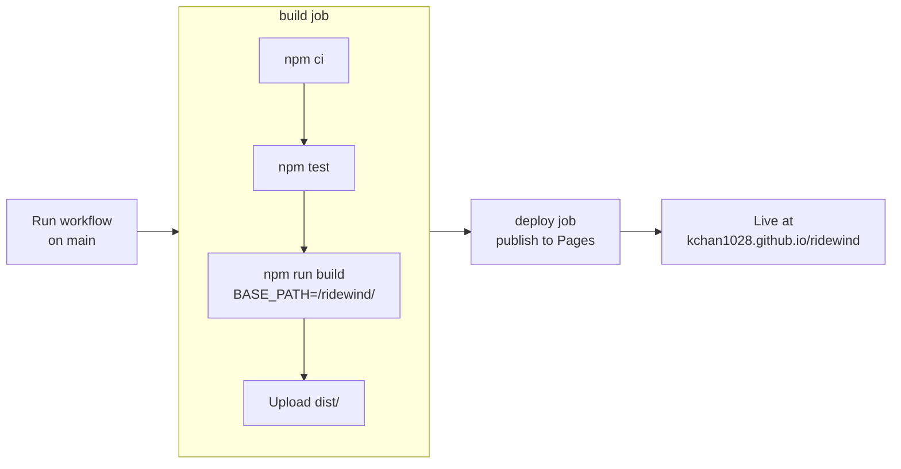

# Deploying RideWind

RideWind builds to a folder of static files, `dist/`, that any static web host can serve. The live site at <https://kchan1028.github.io/ridewind/> is published by a GitHub Pages workflow that only runs when the owner starts it by hand. Merging to `main` doesn't publish anything on its own.

There's no server, database or migration step, and no secrets are involved.

## Build

```bash
npm ci
npm test
BASE_PATH=/ridewind/ npm run build
```

A good build ends with `✓ built in …ms` and lists `dist/index.html` plus one CSS file and one JavaScript file under `dist/assets/`.

Set `BASE_PATH` to the URL path the site will live under, with a slash at each end. Use `/` (the default) for a site at the root of a domain. If it's wrong, the page loads with no styles or scripts.

The production build adds a Content Security Policy `<meta>` tag to `index.html` (see [`src/lib/csp.ts`](../src/lib/csp.ts)). Check the built site with `npm run preview` before publishing it.

## Publish to GitHub Pages

The workflow is [`.github/workflows/deploy-pages.yml`](../.github/workflows/deploy-pages.yml). It installs dependencies, runs the tests, builds with `BASE_PATH=/<repository name>/` and publishes `dist/`.

This one-time setup is already done for this repository: in **Settings → Pages → Build and deployment**, **Source** is set to **GitHub Actions**.



If any step in the `build` job fails, nothing is published and the live site stays as it was.

To publish:

1. Make sure the change you want is merged into `main`.
2. Go to **Actions → Deploy to GitHub Pages → Run workflow**, choose `main`, and press **Run workflow**.
3. Wait for both jobs, `build` and `deploy`, to turn green. The `deploy` job shows the site address when it's done.

To publish on every merge instead, change the workflow's `on:` block to `push: branches: [main]`.

## Check the live site

After a deploy:

1. Open <https://kchan1028.github.io/ridewind/> and force a reload (Shift and the reload button) so you aren't looking at a cached copy.
2. Pick a sample route. The map should draw the route and the verdict should fill in within a few seconds.
3. Open the browser console. There should be no errors, and in particular no `Content-Security-Policy` errors.

## Roll back

GitHub Pages serves whatever the workflow published last. To undo a bad release:

1. Revert the change on `main` with a pull request. On GitHub, the **Revert** button on the merged pull request creates one.
2. Merge it once CI passes.
3. Run **Deploy to GitHub Pages** again, as above.

This keeps `main` and the live site in step, and it works within the branch rules in [maintaining.md](maintaining.md), which block force pushes to `main`.

## Hosting somewhere else

Copy the contents of `dist/` to any static host. Keep three things in mind:

- Build with the right `BASE_PATH` for that host.
- Serve the site over HTTPS. The Content Security Policy tells browsers to upgrade any plain HTTP requests.
- If the host can send response headers, add a `frame-ancestors` rule to stop other sites from framing RideWind. A `<meta>` tag can't set it, which is a known limitation on GitHub Pages (see [SECURITY.md](../SECURITY.md#known-limitations)).

If the new host will bring much more traffic, check the Open-Meteo and OpenStreetMap usage terms first. They're summarised in [data-and-privacy.md](data-and-privacy.md).
