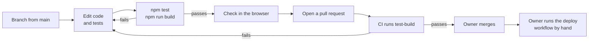

# Developing RideWind

To work on RideWind you need Node.js 20.19 or newer and about two minutes. Clone the repository, run `npm install`, then `npm run dev`, and the app is running at `http://localhost:5173/`. There are no API keys, no database and no `.env` file to set up.

This page covers setup, the everyday commands, how the tests work, and how to debug the parts that talk to outside services. For how the code fits together, read [architecture.md](architecture.md).

## Set up

```bash
git clone https://github.com/kchan1028/ridewind.git
cd ridewind
npm install
npm run dev
```

When the dev server is ready, Vite prints the local address:

```
  VITE v8.3.8  ready in 132 ms

  ➜  Local:   http://localhost:5173/
```

Open it and pick a route from **Try a sample route…**. If the map draws the route and the verdict box fills in after a few seconds, everything is working. If port 5173 is busy, Vite uses the next free port and prints that one instead.

CI runs on Node 22 (see [`.github/workflows/ci.yml`](../.github/workflows/ci.yml)). The minimum, Node 20.19, comes from the `engines` field in [`package.json`](../package.json).

## Configuration

There's one optional environment variable.

| Variable | Used by | What it does |
| --- | --- | --- |
| `BASE_PATH` | [`vite.config.ts`](../vite.config.ts) at build time | Sets the URL path the site is served from. Defaults to `/`. The GitHub Pages workflow sets it to `/ridewind/`. |

```bash
BASE_PATH=/ridewind/ npm run build
```

Everything else is a constant in the code, for example the forecast length (`FORECAST_DAYS` in [`src/lib/weather.ts`](../src/lib/weather.ts)) and the physics defaults (`DEFAULT_RIDER` in [`src/lib/physics.ts`](../src/lib/physics.ts)).

## Commands

| Command | What it does | What success looks like |
| --- | --- | --- |
| `npm run dev` | Starts the Vite dev server with hot reload | `Local: http://localhost:5173/` |
| `npm test` | Runs every unit test once with Vitest | `Test Files 16 passed (16)` and `Tests 158 passed (158)` (as of November 2026) |
| `npm run test:watch` | Reruns the tests when files change | Same summary, then Vitest waits for changes |
| `npm run typecheck` | Type-checks `src/` and `tests/` with TypeScript | No output, exit code 0 |
| `npm run build` | Type-checks, then builds the static site into `dist/` | `✓ built in …ms` and three files listed under `dist/` |
| `npm run preview` | Serves the built `dist/` folder locally | `Local: http://localhost:4173/` |

`npm test` and `npm run build` print a warning that starts with `Your Vite config uses features that are unsupported by configLoader: 'native'`. It's harmless for now. It refers to the `./src/lib/csp` import in `vite.config.ts` having no file extension.

## Tests

Tests live in [`tests/`](../tests), one file per module in `src/lib/`. They run in a simulated browser ([jsdom](https://github.com/jsdom/jsdom)), so `DOMParser` and `localStorage` work. IndexedDB comes from [`fake-indexeddb`](https://github.com/dumbmatter/fakeIndexedDB).

No test calls a real service. The network code accepts a `fetchImpl` option, and the tests pass in a fake `fetch` that returns canned responses, timeouts or errors. See [`tests/weather.test.ts`](../tests/weather.test.ts) for the pattern.

The interface code in `src/ui/` has no automated tests. Check interface changes by hand in the browser (see [Check a change](#check-a-change)).

To run one test file:

```bash
npx vitest run tests/physics.test.ts
```

To run only the tests whose name contains some text:

```bash
npx vitest run -t "headwind"
```

## Make a change



1. Create a branch from `main`.
2. If the change is to a calculation, put it in `src/lib/` and add or update a test in `tests/`. Keep DOM code out of `src/lib/` (GPX parsing is the one exception, because it uses `DOMParser`).
3. If the change is to the interface, edit [`index.html`](../index.html) for markup, [`src/styles.css`](../src/styles.css) for styling and [`src/ui/app.ts`](../src/ui/app.ts) for behaviour.
4. Run `npm test` and `npm run build`. Both must pass, because CI runs the same two commands.
5. Open a pull request. [CONTRIBUTING.md](../CONTRIBUTING.md) explains the rest.

## Check a change

Automated tests cover the maths. For anything you can see, also check it in the browser:

1. Run `npm run dev` and load each of the three sample routes.
2. Switch between **A constant average speed** and **Power and bike setup**.
3. Press **Reverse direction** and step the departure with **−1 h** and **+1 h**.
4. Narrow the window to about 375 px wide and check nothing scrolls sideways.
5. Tab through the page with the keyboard. Every control should be reachable and show a focus outline.

Before you open the pull request, run `npm run build && npm run preview` too. The production build adds a Content Security Policy that the dev server leaves out, so a change that loads a script, style or image from somewhere new can work in `dev` and break in `preview`. Open the browser console and look for `Content-Security-Policy` errors. To allow a new source, edit [`src/lib/csp.ts`](../src/lib/csp.ts) and its test.

## Debugging

**Forecast requests.** Open the browser's developer tools, go to the Network tab and filter by `open-meteo`. Loading a route sends one request to `api.open-meteo.com/v1/forecast` with up to 20 coordinates. The `X-RateLimit-Cost` response header shows how many free calls it used. Changing the departure time or speed sends no new request.

**Rate limits while developing.** Each route you load costs about 20 of Open-Meteo's free calls, and the free limit is fewer than 10,000 a day. The forecast is only kept in memory, so after a page reload, loading a route fetches it again. If you hit the limit, the app shows *Open-Meteo's free usage limit has been reached for now* and you'll have to wait. For work on calculations, use the tests, which never call the network.

**Stored data.** In developer tools, open Application (Chrome) or Storage (Firefox). Settings are in Local Storage under `ridewind:settings:v1`. Saved routes are in IndexedDB, database `ridewind`, store `routes`. Delete them there, or use **Data & settings → Delete all local data** in the app.

**Errors.** Errors meant for the rider are `AppError` objects with a fixed `code` (see [`src/lib/errors.ts`](../src/lib/errors.ts)). The message is written for the rider. Some errors also carry a `detail` with the technical reason, such as `HTTP 503`. Common problems and fixes are in [troubleshooting.md](troubleshooting.md).
