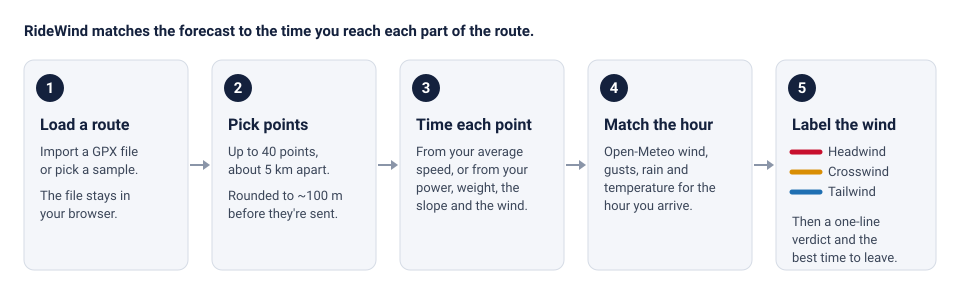
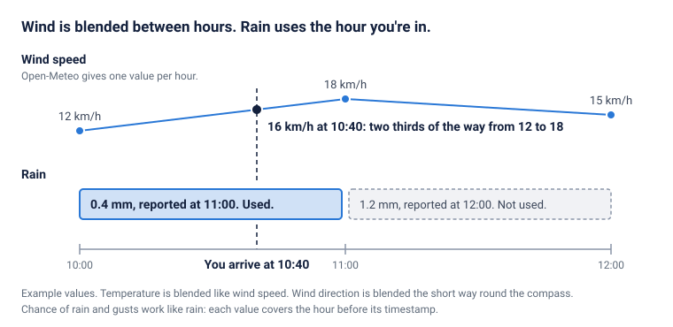
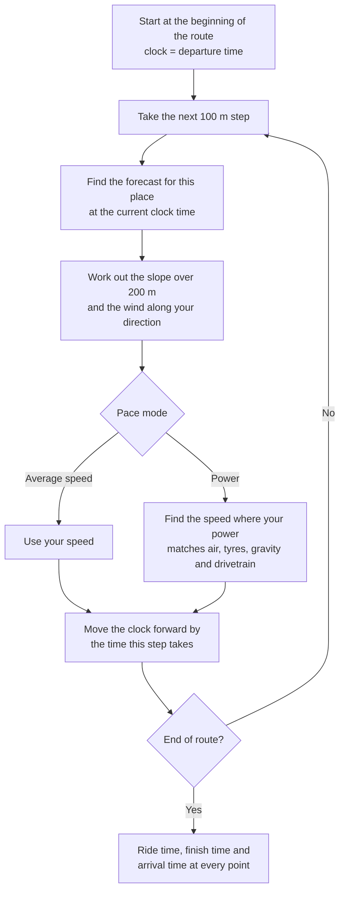
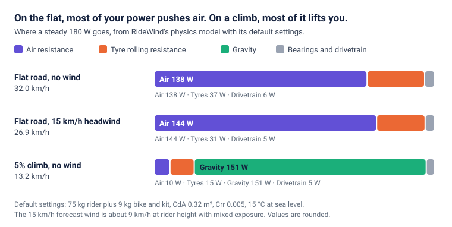

# How RideWind estimates your ride

RideWind works out when you'll reach each part of the route, then reads the forecast for that place at that hour. Timing comes from a fixed average speed or from a physics model that uses your power, the slope and the wind. Everything it shows is either a **forecast** straight from Open-Meteo or an **estimate** that RideWind calculated from it.



The rest of this page explains each step, what RideWind assumes, and what it leaves out.

## Forecast or estimate?

Values marked **forecast** (solid dot) come straight from Open-Meteo. Values marked **estimate** (hollow dot) or **calculated** are RideWind's own maths.

## How the forecast is matched to your ride

- **Arrival times** come from your average speed or from the physics model below, plus any planned stop time (see below).
- **Forecast points:** RideWind picks up to 40 points spread evenly along the route, about 5 km apart, which keeps that spacing on rides up to about 195 km. Each section of the map uses the nearest point's forecast, at the time you're expected to reach that section.
- **Between hours:** Open-Meteo gives one value per hour. For temperature and wind speed, RideWind blends the two hours either side of your arrival in a straight line. Wind direction is blended the short way round the compass, so 350° to 10° passes through 0°, not 180°. Rain, chance of rain and gusts are reported by Open-Meteo for the hour *before* each timestamp, so RideWind uses the hour your arrival falls in. If you'd arrive after the forecast ends, the section shows "No forecast" and RideWind doesn't guess.
- **Rain wording:** the summary leads with the highest chance of rain along the ride and gives the heaviest forecast rate as what to expect if it rains. Below a 20% chance it says *low chance of rain*, because a model can forecast a heavy rate at a low chance, and the rate alone would overstate the risk.
- **Splitting the wind:** wind direction is where the wind blows *from*. If you're heading in direction θ and the wind comes from φ:
  - headwind = speed × cos(φ − θ). Positive is a headwind, negative is a tailwind.
  - crosswind = speed × sin(φ − θ). Positive means the wind comes from your right.

  Your direction at each point is measured over 250 m either side, so GPS wobble doesn't flip it.
- **Naming the wind:** a headwind is within 45° of straight in your face, a tailwind within 45° of straight behind you, and anything else is a crosswind. Wind under 5 km/h counts as calm. These cut-offs are just how RideWind labels things on screen.
- **Wind height:** the forecast is for wind 10 m above the ground. It doesn't know about shelter from buildings, trees, hedges, cuttings or hills, and you'll usually feel less wind than this at road level.
- **Climbing:** small ups and downs under 3 m are ignored as GPS noise. If only some points have elevation, RideWind says so and uses the points that do.

### What blending between hours looks like

If you'd reach a point at 10:40, RideWind takes two thirds of the change between the 10:00 and 11:00 wind speeds. Rain is different, because Open-Meteo reports it for the hour that ends at each timestamp.



### How the wind gets its label

Wind direction is compared with your direction of travel at that point. The worked example shows the headwind and crosswind sums from the list above.


## Physics model (power mode)

In power mode, RideWind finds the speed at which your power matches the forces slowing you down: air resistance, tyre friction, gravity on climbs, and a little friction in the wheel bearings and drivetrain. It uses the road cycling model from Martin, Milliken, Cobb, McFadden and Coggan (1998), "Validation of a mathematical model for road cycling power", *Journal of Applied Biomechanics* 14(3):276–291. For each step, RideWind finds the ground speed *v* at which your power at the pedals equals:

```
P = ( ½·ρ·CdA·v_air·|v_air|·v          aerodynamic drag, v_air = v + headwind
    + Crr·m·g·cos(atan G)·v             rolling resistance
    + m·g·sin(atan G)·v                 gravity
    + v·(91 + 8.7·v)·10⁻³ ) / η         wheel bearings; η = 0.976 drivetrain efficiency
```

`m` is rider plus bike mass, `g` = 9.80665 m/s² and `G` is the gradient. RideWind finds the speed by repeatedly halving the range it could be in (bisection).

- **Air density** (ρ) comes from the forecast temperature and the height above sea level. Warm air and high roads mean thinner air and less drag. Humidity is ignored.
- **Wind at rider height:** the 10 m forecast wind is scaled down to about 1.2 m, roughly where your body is, using v·(1.2/10)^α (the Hellmann power law). You pick how exposed the route is: open (α 0.14, about 74% of the forecast), mixed (α 0.25, about 59%) or sheltered (α 0.33, about 50%). Only the part of the wind along your direction of travel counts. The extra drag from wind hitting you side-on is ignored.
- **Steps:** RideWind moves along the route 100 m at a time (the loop is drawn below). The slope is measured over 200 m centred on each step and capped at 25% up or down, so a bad elevation reading can't produce a wall. The clock moves forward step by step, so each step meets the forecast for when you'd actually get there.
- **Limits:** speed never goes above your **max descent speed**, on the assumption that you brake. On very steep climbs it never drops below 4 km/h, about walking pace.
- **Planned stops:** you can add a total stop time in minutes, in either pace mode. It's spread evenly by distance, so halfway along you've used half of it. Later arrival times, the forecast they're matched to, and the finish all move back. The average speed shown is moving speed, without the stops.
- **Left out:** speeding up and slowing down, corners, traffic, unplanned stops, riding in a group, getting tired and changing your power. Where a step has no forecast, RideWind assumes still air and 15 °C and warns you.
- **No silent flat routes.** If the route has no elevation, or only some, power mode asks you to choose: look up elevation, or **Estimate as if flat**. Both buttons are in the verdict. Until you choose, the wind verdict and times use your average speed, and the verdict says so ("timed at 25 km/h average"). A flat estimate is labelled "physics estimate, flat", the verdict says "(flat estimate)", and a warning is shown. In average-speed mode, the elevation chart says "No elevation data" instead of drawing a flat line.
- **Defaults:** 180 W, 75 kg rider, 9 kg bike and kit, CdA 0.32 m² (hands on the hoods), Crr 0.005 (everyday road tyres), 55 km/h max descent, mixed exposure. Change them to match you.

### One step of the simulation



Because the clock moves with you, a ride that starts calm can still meet a headwind that arrives later in the day.

### Where your power goes

This chart uses the model with its default settings to show why wind matters so much on the flat. Air resistance takes about three quarters of your power on a flat road, so a headwind costs you speed directly. On a 5% climb you're slower, air resistance drops away, and lifting your weight takes most of the effort.



| Situation | Speed | Air | Tyres | Gravity | Bearings and drivetrain |
| --- | --- | --- | --- | --- | --- |
| Flat road, no wind | 32.0 km/h | 138 W | 37 W | 0 W | 6 W |
| Flat road, 15 km/h headwind | 26.9 km/h | 144 W | 31 W | 0 W | 5 W |
| 5% climb, no wind | 13.2 km/h | 10 W | 15 W | 151 W | 5 W |

Settings: 180 W, 75 kg rider, 9 kg bike and kit, CdA 0.32 m², Crr 0.005, 15 °C at sea level, mixed exposure (the 15 km/h forecast wind is about 9 km/h at rider height). Values are rounded.

The tests check the model against sums worked out by hand for each force, check that working back from speed to power gives the same answer, and check that it reacts the right way to more power, wind, slope, drag, tyre friction and weight. A 200 W, 84 kg rider with CdA 0.32 and Crr 0.005 comes out at about 33 km/h on a calm, flat road.

## How close are the estimates?

In November 2026 the power model was run against five of the maintainer's own recorded road rides, 73 to 141 km long. Each ride used the rider's weight plus a 9 kg bike, the default CdA, Crr, descent cap and mixed exposure, the real start time, and Open-Meteo's archived forecast for that day. The prediction was compared with the ride's moving time.

| Ride | Distance | Climbing | Normalised power | Predicted | Actual moving time | Difference |
| --- | --- | --- | --- | --- | --- | --- |
| A | 72.6 km | 358 m | 172 W | 2 h 33 min | 2 h 52 min | −11.0% |
| B | 88.5 km | 564 m | 182 W | 2 h 58 min | 2 h 54 min | +1.9% |
| C | 141.4 km | 1,081 m | 170 W | 5 h 19 min | 5 h 24 min | −1.6% |
| D | 113.5 km | 1,247 m | 177 W | 4 h 25 min | 4 h 31 min | −2.5% |
| E | 86.0 km | 95 m | 190 W | 2 h 41 min | 3 h 00 min | −10.5% |

What this shows:

- **Which power figure you enter matters most.** With normalised power the model was 4.7% fast on average. With average power, which counts coasting as zero, it was 5.6% slow on average and up to 11% slow. A steady figure between the two is a reasonable starting point.
- **The worst misses were flat or stop-start rides** (A and E), where traffic, junctions and easy pedalling mean less steady effort than the power figure suggests.
- **Wind changed these predictions by 0 to 3%.** All five were loops, where headwind and tailwind largely cancel. The wind matters more on point-to-point rides and for choosing a direction.
- **Group rides need a lower CdA.** Three rides were in groups, where drafting cuts air drag below the default.

Five rides from one rider is a small check, not a validation. Expect errors of around 10%, and adjust your power or CdA once you've compared a few of your own rides.

## Comparing start times and directions

RideWind runs the same calculation for up to six start times (every 1, 2, 3 or 6 hours from the one you chose) in both directions. For each, it shows the ride time, the finish time (marked when it's after sunset or before sunrise), the share of the distance into a headwind and the highest chance of rain. It only lists options that finish before the forecast runs out. Start times where neither direction would finish before dark are listed after the last one that does, behind **Show later times**. If none finishes in daylight, or the start time in use is one of them, they're all shown. In power mode, **Best** is the quickest ride. In average-speed mode every ride takes the same time, so **Best** is the one with the least headwind. An option the forecast doesn't fully cover, or that starts before sunrise or finishes after sunset at the start point, is never marked Best. If the remaining options are within 5 minutes (power) or 3 km/h of average wind (average speed) of each other, none is marked and the table says there's no clear best.

All of this is a planning aid built on forecasts and a simplified model. It's only been checked against a few real rides and isn't race advice. RideWind doesn't claim to match any commercial cycling weather service.
