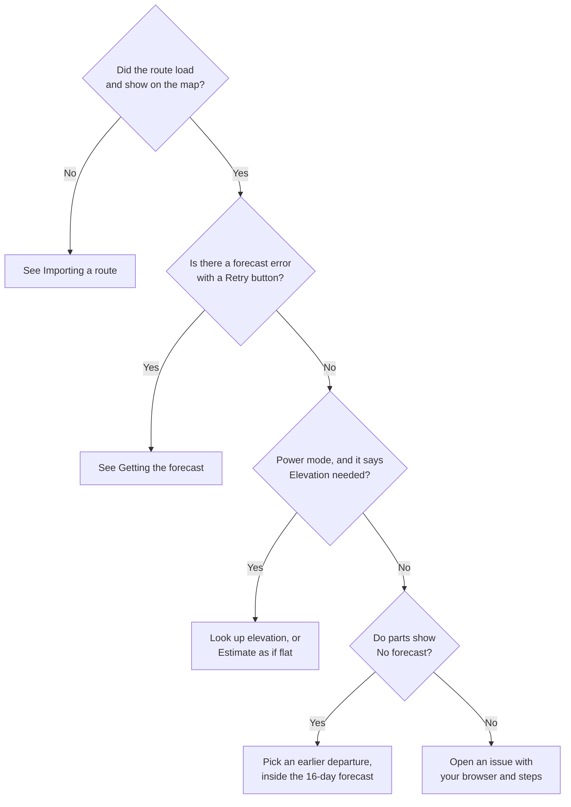

# Troubleshooting

Most RideWind problems come from three places: the GPX file, the free weather service's limits, or the browser blocking storage. Each section below starts with the message you'll see, then explains the cause and the fix. Messages are quoted from the code, so you can search this page for the exact text.

If the results don't appear at all, this shows where RideWind usually stops:

If your problem isn't here, [open an issue](https://github.com/kchan1028/ridewind/issues/new/choose) and include the message, your browser, and (if you can share it) the GPX file. Report security problems privately as described in [SECURITY.md](../SECURITY.md).

## Importing a route

**"That file is empty."** or **"That file isn't valid GPX (the XML couldn't be read)."**
The file is blank or damaged, often from an interrupted download. Export it again from your route planner or bike computer.

**"That file isn't a GPX file."**
RideWind only reads GPX. If you have a FIT or TCX file, convert it to GPX first. Most route planners can export GPX directly.

**"This GPX file only has waypoints."** or **"No track or route points were found in this GPX file."**
RideWind needs track points (`<trkpt>`) or route points (`<rtept>`). Waypoints (`<wpt>`) mark single places, not a line to ride. Export the route as a track or route instead.

**"This GPX has fewer than two distinct points"** or **"Every point in this GPX has missing or out-of-range coordinates."**
The points are there but unusable: all in the same spot, or with missing or impossible coordinates. Export the file again.

**"That file is … MB. RideWind accepts GPX files up to 25 MB."**
Very long recordings can pass this limit. Export the planned route rather than a recorded ride, or simplify the track in your route planner.

**Climbing shows as "unknown".**
The file has no elevation. This is on purpose: RideWind never treats missing elevation as zero. Press **Look up elevation** to fetch it from a terrain model.

## Getting the forecast

**"Open-Meteo's free usage limit has been reached for now."**
Open-Meteo's free plan allows fewer than 10,000 calls a day, and each route costs one call per forecast point: about 21 for a 100 km ride, and at most 40. Wait and press **Retry forecast**. If the service sent a wait time, the message includes it ("Try again in about N min."). Your route stays loaded.

**"Couldn't reach Open-Meteo."** or **"Open-Meteo didn't respond in time."**
Your connection dropped, or the request took longer than 20 seconds. Check you're online and press **Retry forecast**. Browser extensions that block requests can also cause this. Allow `api.open-meteo.com`.

**"Open-Meteo is temporarily unavailable."**
The weather service returned a server error. Try again in a few minutes.

**"Open-Meteo could not provide data for this route."**
The service turned the request down. This is rare. Note the route's location and [open an issue](https://github.com/kchan1028/ridewind/issues/new/choose).

**Parts of the route show "No forecast".**
You'd reach those parts after the forecast ends, which is 16 days out. Choose an earlier departure. RideWind never fills these gaps with made-up values. In power mode it assumes still air and 15 °C for those parts and shows a warning.

**The forecast looks out of date.**
RideWind fetches the forecast once per route and keeps it until you reload the page. To get a newer one, press **Refresh forecast** under the results.

## Drawing a route

When routing fails, the drawing goes back to its last complete version and the panel offers **Retry**, **Draw as straight line** and **Dismiss**.

**"Couldn't reach the routing service."** or **"The routing service didn't respond in time."**
The request didn't get through within 20 seconds, often because you're offline. Check your connection and press **Retry**, or draw that section as a straight line.

**"The routing service is busy."**
The server is rate limiting requests. Wait a few seconds and press **Retry**. RideWind already spaces requests at least 1.1 seconds apart.

**"No road was found near that point."**
The point is too far from any road or path the cycling profile can use. Move it closer to a road, or switch *New sections* to **Straight line**.

**"The routing service couldn't find a cycling route between those points."**
The roads between them don't connect for bikes in OpenStreetMap, for example across a motorway or a private road. Add a point on the road you want, or draw that section as a straight line.

**"That section is too long for the routing service."**
The public server limits one route to about 150 km. Add a point part way along.

**"Couldn't reach the address search."**, **"The address search is busy."** or **"No places found"**
Find a place uses OpenStreetMap's Nominatim. Check your connection, wait a moment and search again, or add a town or postcode. You can always move the map by hand.

**The route follows a different road than you wanted.**
Routing picks what the cycling profile prefers. Add a point on the road you want, and check the line in **Review route** before you use it.

## Timing and estimates

**In power mode, the verdict says "timed at … average" and asks about elevation.**
Power timing needs gradients, and this route has no elevation (or only some). Until you choose, RideWind times the ride at your average speed so you still get the wind verdict. Press **Look up elevation**, or **Estimate as if flat** to accept a clearly labelled flat-road estimate. Both buttons are in the verdict.

**The ride time seems wrong.**
Check the settings under **Departure and pace**. In power mode, your power, weight, drag area (CdA) and exposure have the biggest effect. Neither mode includes stops, so add your café time yourself. How the estimate works is in [model.md](model.md).

**The departure time is in a different timezone from mine.**
That's intended. Times use the route's own timezone, which comes from the forecast, so a ride planned while travelling shows local times at the route.

## Saving and moving data

**"This browser isn't allowing RideWind to save data"**
Your browser is blocking site storage, which is common in private browsing windows or with strict privacy settings. Use a normal window, or allow site data for RideWind. You can still plan rides without saving.

**Saved routes are missing.**
Saved routes live only in the browser and device where you saved them. They don't sync. Clearing site data deletes them for good. To move routes, use **Data & settings → Export data** on one device and **Import data** on the other.

**"That file can't be imported: …"**
The file isn't a RideWind export, or it was edited and no longer passes the checks. Only files made with **Export data** can be imported. The text after the colon says what failed.

## Development problems

**`npm install` fails or warns about the engine.**
You need Node.js 20.19 or newer. Check with `node --version`.

**The build works in `npm run dev` but something breaks in `npm run preview` or on the live site.**
The production build adds a Content Security Policy that the dev server doesn't. Look for `Content-Security-Policy` errors in the browser console, and see [development.md](development.md#check-a-change).

**The deployed site loads without styles or scripts.**
The assets are being requested from the wrong path. Build with `BASE_PATH` set to the folder the site is served from, for example `BASE_PATH=/ridewind/ npm run build`. See [deployment.md](deployment.md).

**A warning about `configLoader: 'native'` appears when testing or building.**
It's harmless. It refers to an import without a file extension in `vite.config.ts`.
